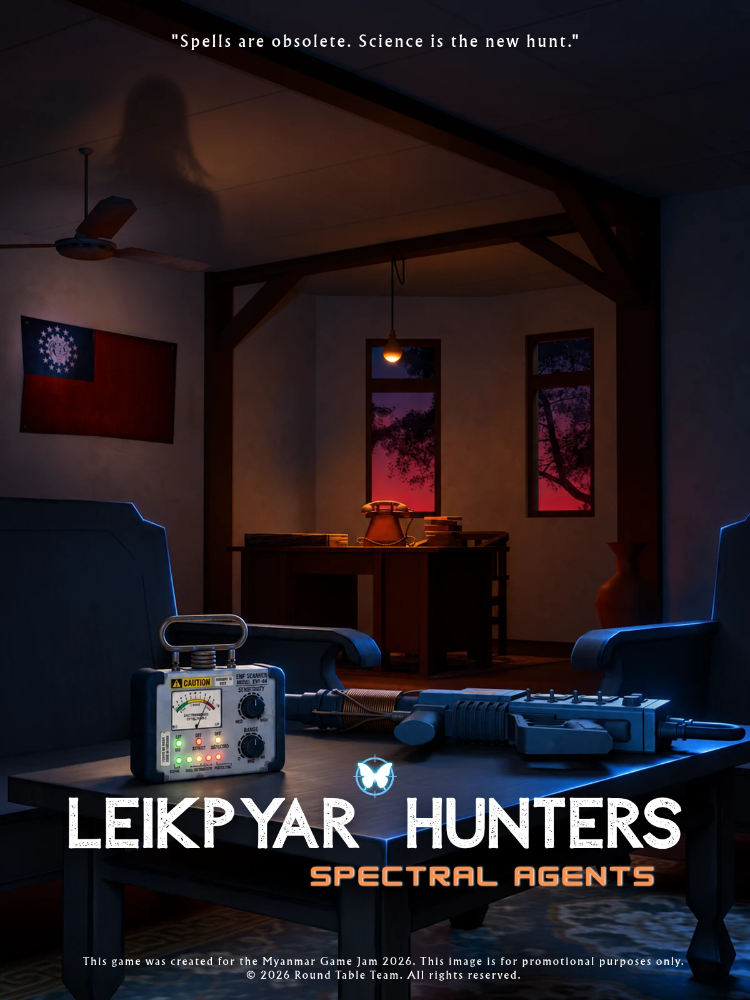

# Leikpyar Hunters (Spectral Agents) - Field Manual

> **Play it now, in your browser (phone or PC): <https://leikpyarhunters.org/play/>**
> Website, 3D gallery and leaderboard: <https://leikpyarhunters.org/>

<p align="center">
  
</p>

## 1. GAME IDENTITY

| | |
|---|---|
| **Game Title** | Leikpyar Hunters (Spectral Agents) |
| **Version** | v1.1 (Public Beta) |
| **Developer** | Round Table Team |
| **Project** | Myanmar Game Jam 2026 Submission |
| **Engine** | Unity 6 (6000.0.46f1), Universal Render Pipeline |
| **Platform** | WebGL: Chrome, Edge, Firefox, Safari on PC, Android and iPhone |
| **Languages** | English and Myanmar (Burmese) |

## 2. MISSION BRIEFING

What happens when the supernatural is no longer a matter of faith, but a matter of physics?
Set in a 1980s Myanmar estate, this game brings to life the imaginative fusion of science and the spirit world.

You are a **spectral agent** on the night shift. Scan the old house, pull the glowing souls out of the dark,
seal them, and survive until dawn.

## 3. THE CORE PROTOCOLS

1. **Detect:** Find the ghost using spectral frequencies.
2. **Catch:** Weaken the entity with the Proton Gun.
3. **Seal:** Contain the ghost within the Faraday Vault.
4. **Upgrade:** Enhance gear at the GCC workstation to survive.

### A night in the house

1. At night, souls (Orbs) and Mirages hide in the rooms, and the Solid ghost walks the house.
2. Scan with the EMF Scanner, tether a ghost with the Proton Gun, and walk it to the **EM-Tethering Machine** (the generator).
3. The machine turns the soul into an **MEP Phial**. You can make only a limited number of MEP in one night (3 to begin with, up to 6 with upgrades).
4. Put the MEP in a **Faraday Vault** (cage) and put the cage on the table. The **GCC worker** checks it and gives you points.
5. Spend the points in **Upgrades** (U) to make your gear stronger.
6. Survive until dawn. Your best night goes on the online leaderboard.

## 4. FIELD CONTROLS

| Key | Action |
|---|---|
| `W` `A` `S` `D` | Movements |
| `1` `2` `3` | Select Equipment (Gun, Scanner, Injector) |
| Left Click | Pull the Ghost / Use Injector |
| `F` / `E` | Use / Take / Interact |
| `O` | Scanner Toggle (On/Off) |
| `T` | Torch (Flashlight) |
| `B` | Backpack (Inventory) |
| `H` | Hide (Under bed or in wardrobe) |
| `U` | Upgrades (Only at the GCC Worker station) |
| `P` | Settings (the web game cannot use Esc) |

On a phone the game shows a joystick, a look pad and big buttons, and asks the player to go full screen
(with a moving guide for Android and for iPhone Safari).

## 5. SPECTRAL GEAR & EQUIPMENT

- **EMF Scanner:** Detects electromagnetic disturbances caused by spectral entities.
- **Proton Gun:** Fires an ionized particle beam to tether and weaken ghosts.
- **MEP Phial & Faraday Vault:** The MEP Phial captures the soul essence, while the Faraday Vault provides permanent containment.
- **Bio-cellular Injector:** Stabilizes the agent's vital signs and cellular integrity.
- **EM-Tethering Machine:** The generator that turns a tethered soul into an MEP Phial.

## 6. THREAT CLASSIFICATION

| Class | Name | Description |
|---|---|---|
| **Class 1** | Soul Orb | A floating cluster of pure energy (a glass butterfly). Minimal physical threat. |
| **Class 2** | Mirage | Unstable semi-humanoid form. Flickers and distorts reality. |
| **Class 3** | Solid | Fully manifested entity capable of physical aggression. Extremely dangerous. |

## 7. ONLINE FEATURES

- **Agent account:** pick a codename, a password and Male or Female. You get an Agent ID. The same account works on the website and in the game.
- **Leaderboard:** one best night for each agent (a soul sealed is 100 points, a cage checked is 500, a night survived is 250).
- **Cloud save:** the game can be saved and loaded on any device.
- **Admin panel** (for the team): charts of the agents, text and picture editing in English and Myanmar, user management.

## 8. REPOSITORY CONTENTS

```
Unity/            the game project: C# scripts, shaders, WebGL plugins, the 3 scenes, our prefabs and materials, project settings, package list, Burmese text pipeline
Website/          the website (HTML/CSS/JS), the admin panel, and the Python server
Deploy/           the upload tools (no passwords in them)
TECHNICAL_NOTES.md   how it is built (architecture, systems, WebGL, server, security)
LICENSE.md        rights and third-party credits
```

The Unity folder contains **our own code, scenes, prefabs, materials and project settings**. The 3D models, textures, sounds and the paid or third-party packages
are **not** in this repository (their licences do not allow it, and the 3D art is protected on purpose), so a scene opened from this repository
shows missing models until the art is added. See `TECHNICAL_NOTES.md` section 11 for how to open it in Unity and for the list of what is left out.

## 9. TEAM

| Role | Name |
|---|---|
| Game Designer | Ayar Min |
| Sound & Music | Wai Yan Min Thu |
| Developer | Swan Htet |
| 3D Art | May Thinzar Khin |

Full credits (third-party models, effects, fonts and tools) are in [`LICENSE.md`](LICENSE.md) and on the website.

## 10. LICENSE

Copyright (c) 2026 Leikpyar Hunters / Round Table Team. **All rights reserved.** Each creator keeps the rights to their own part.
The code is published so the Myanmar Game Jam 2026 judges and the community can read it. Copying, reuse or redistribution
needs written permission. See [`LICENSE.md`](LICENSE.md).
